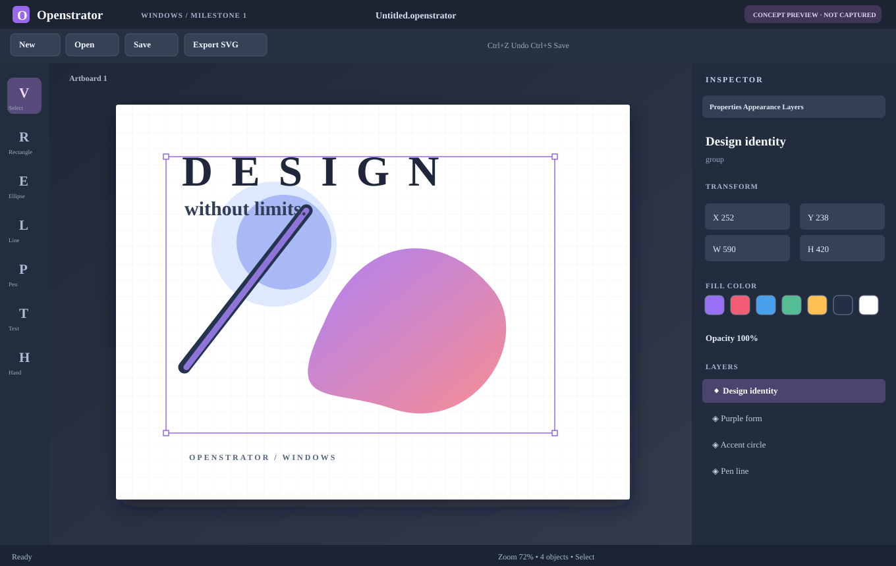
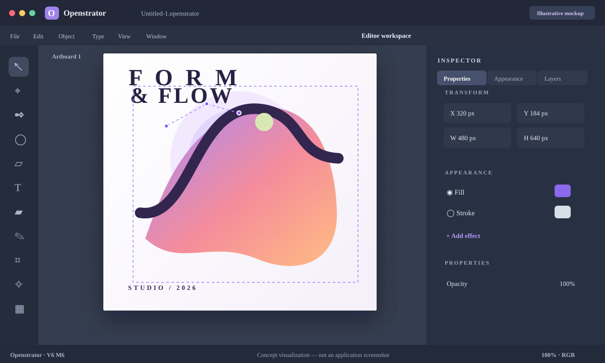
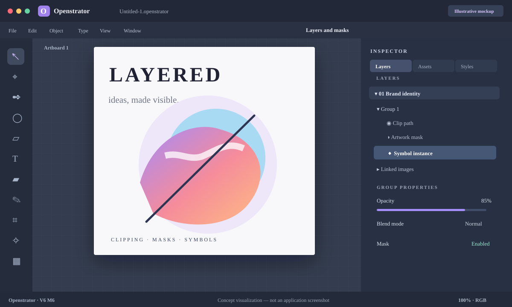
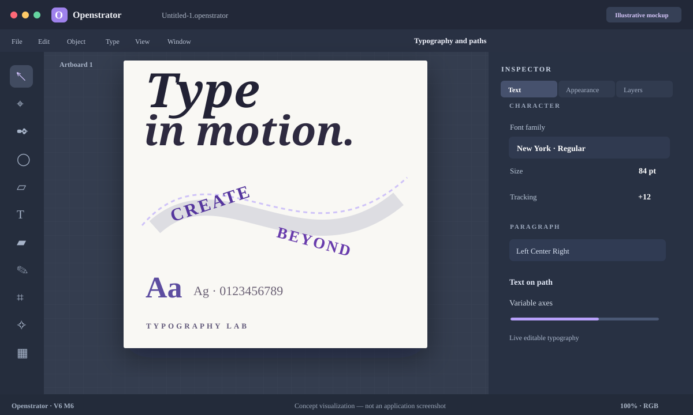

# Openstrator

**Native macOS vector and raster design editor** — V6 Milestone 6 (4 October 2026).

Openstrator is an original vector-editing project built with **SwiftUI, AppKit, CoreGraphics, CoreText, and Core Image**. It is independent of Adobe products.

> **Build status:** Source packages, **not precompiled .app files**. Portable QA: 126 core tests and 87 framework-free self-checks passed in the original release. A successful native macOS build/launch of M6 has not been confirmed.

## Windows version (C++20 · Native Windows editor)

**Windows Milestone 1 is in development:** the original macOS V6 M6 release remains available above. The initial Windows implementation uses Win32, Direct2D and DirectWrite, with basic vector editing and .openstrator document support.

[Windows M1 source, build instructions and compatibility notes](windows/README.md) · [Download Windows build artifact from GitHub Actions](https://github.com/infernaldudd/Openstrator/actions/workflows/windows-build.yml)

Windows M1 is **not** the full M6 Mac feature set. Compatibility is partial; advanced imported M6 documents are saved to a new copy rather than overwriting the original.

## Download V6 M6

| Mac | Release source and Terminal builder |
| --- | --- |
| Intel (x86_64) | [Intel ZIP](releases/Openstrator-Intel-V6-M6-Terminal.zip) |
| Apple Silicon (arm64) | [Apple Silicon ZIP](releases/Openstrator-AppleSilicon-V6-M6-Terminal.zip) |

Each ZIP includes `BUILD_OPENSTRATOR.command`, source, assets, tests, and original QA notes. Extract the matching archive on macOS (Ventura or later) and run the Terminal builder. The resulting app is ad-hoc signed, not notarized.

## Preview gallery

These are **illustrative interface mockups based on the source layout**, not screenshots of an actual M6 build (a working Mac was not available for verification).

## V6 M6 capabilities

- Bézier/vector paths, shapes, snapping and artboards
- Typography and text on paths
- Multi-fill and stroke appearances, live effects
- Image placement and raster workflow
- Nested layers, clipping groups, opacity masks
- Embedded objects, linked assets, symbols and shared graphic styles
- Layer thumbnails and resource library

## Verification and limitations

See `QA_REPORT.md` within either release ZIP. The portable verification suite is not a substitute for compiling and launching on real macOS. Original source has not been changed as part of this archival upload.

**Original archive SHA-256**:

- Intel: `d58b986df1373e6e6f614cbeecc2284d42dfc5c86074743261bc06a67c95993a`
- Apple Silicon: `776ca970c5763eae0f129625a74bc162d15c5510e6cb225dcabb8d8f165606c4`

© Openstrator project. Review the included `LEGAL-NOTES.md` before commercial distribution.
