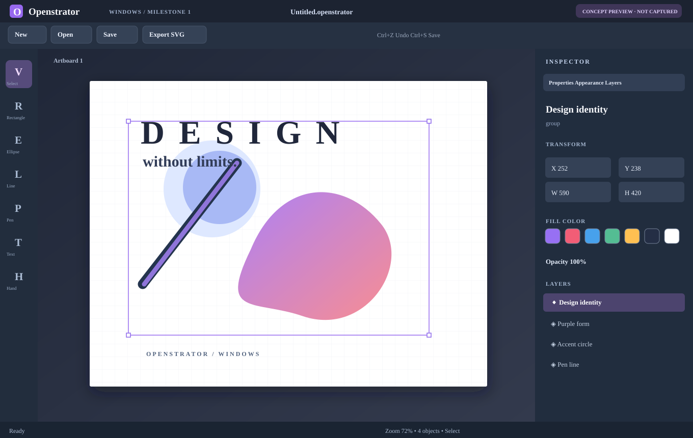
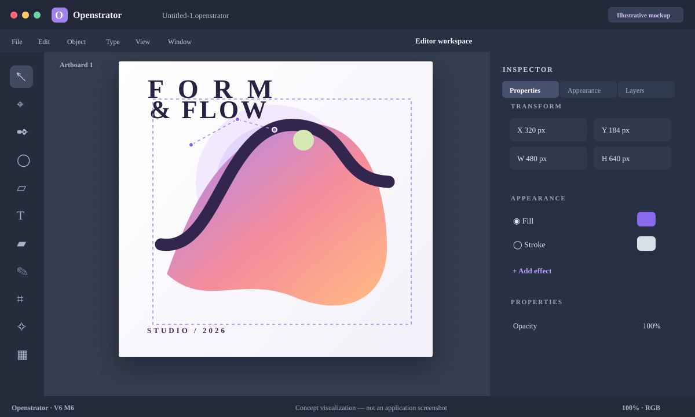
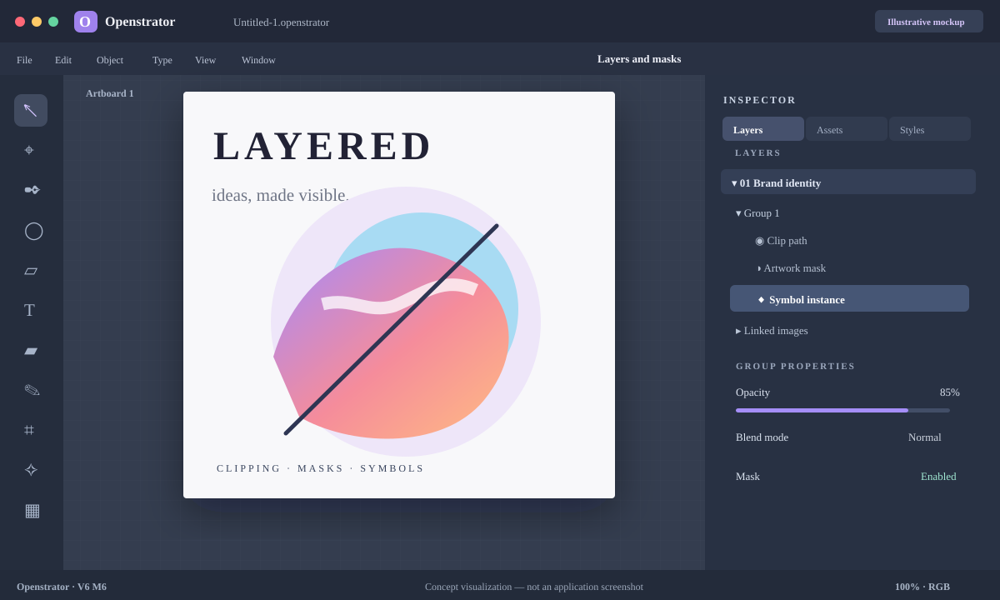
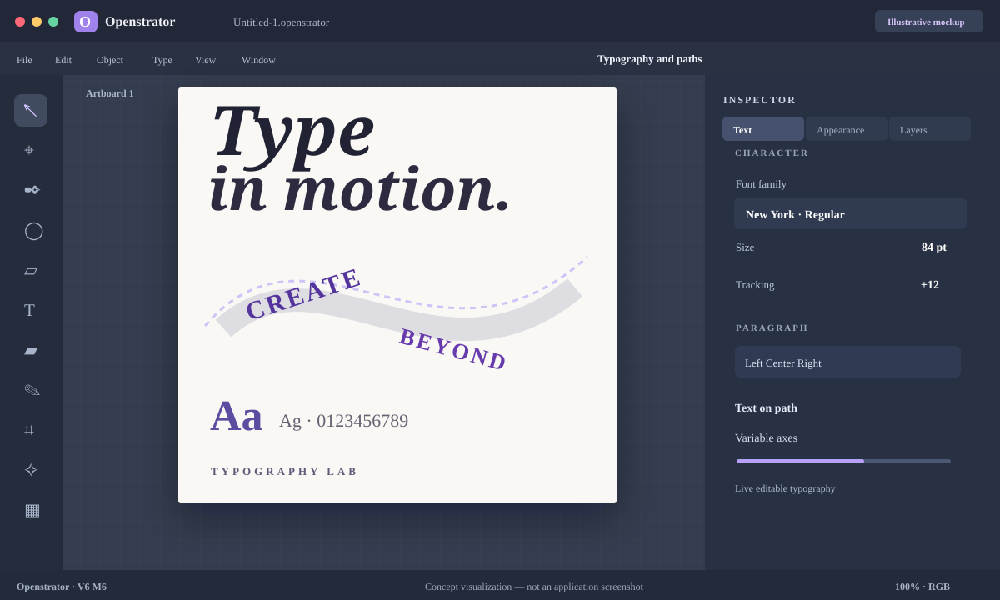

# Openstrator

**Native macOS vector and raster design editor** — M6.1 Mac compiler repair and M7 Illustrator-class parity development.

Openstrator is an original vector-editing project built with **SwiftUI, AppKit, CoreGraphics, CoreText, and Core Image**. It is independent of Adobe products.

> **Build status:** User screenshots from 2026-11-21 confirm that M6.1 launched on Apple Silicon. Portable checks: 126 core tests / 87 self-checks. A full native regression run and Illustrator-class functional parity are **not** claimed.

## Windows version (C++20 · Native Windows editor)

**Windows Milestone 1 is in development:** the original macOS V6 M6 release remains available above. The initial Windows implementation uses Win32, Direct2D and DirectWrite, with basic vector editing and .openstrator document support.

[Download Windows M1 (x64 ZIP)](releases/Openstrator-Windows-M1-x64.zip) · [Windows source and instructions](windows/README.md) · [CI build verification](https://github.com/infernaldudd/Openstrator/actions/workflows/windows-build.yml)

Windows M1 is **not** the full M6 Mac feature set. Compatibility is partial; advanced imported M6 documents are saved to a new copy rather than overwriting the original.

## Download V6 M6 (archival; superseded by M6.1)

The M6 ZIP files below predate the Apple Silicon compiler fixes in M6.1 and may not compile without them. The corrected source is in the `milestone/m7-illustrator-parity` branch.

| Mac | Release source and Terminal builder |
| --- | --- |
| Intel (x86_64) | [Intel ZIP](releases/Openstrator-Intel-V6-M6-Terminal.zip) |
| Apple Silicon (arm64) | [Apple Silicon ZIP](releases/Openstrator-AppleSilicon-V6-M6-Terminal.zip) |

Each ZIP includes `BUILD_OPENSTRATOR.command`, source, assets, tests, and original QA notes. Extract the matching archive on macOS (Ventura or later) and run the Terminal builder. The resulting app is ad-hoc signed, not notarized.

## M7.1a — variable-width vector strokes (current development branch)

The first M7 feature slice includes five editable width-profile presets for open vector paths, integrated into the Appearance Inspector, classic and stacked renderers, document persistence and SVG outline export.

**Source and CI:** [M7.1a review PR #2](https://github.com/infernaldudd/Openstrator/pull/2) · [Native Apple Silicon + Intel build workflow](https://github.com/infernaldudd/Openstrator/actions/workflows/macos-build.yml) · [M7.1a QA report](src/QA_REPORT.md).

The ZIP archives currently listed in the M6 section are old archival files, not the M7.1a packages. M7.1a source ZIP downloads are provided in the originating ChatGPT conversation. Native CI can publish built Mac app artifacts if the checks pass. No Illustrator-wide feature parity is claimed.

## Mac launch evidence and M7 development

- [First M6.1 Apple Silicon smoke-test observations](docs/M6.1_APPLE_SILICON_SMOKE_TEST.md)
- [M7 Illustrator-class feature-parity tracker](docs/M7_ILLUSTRATOR_FEATURE_PARITY.md)
- [M7 tracking issue](https://github.com/infernaldudd/Openstrator/issues/1)

User-supplied screenshots show the M6.1 editor running on Apple Silicon, but do not establish full feature correctness. M7 aims at original functional equivalents, without Adobe branding or proprietary implementation.

## Preview gallery

These are **illustrative interface mockups based on the source layout**, not screenshots of an actual M6 build (a working Mac was not available for verification).

## V6 M6 capabilities

- Bézier/vector paths, shapes, snapping and artboards
- Typography and text on paths
- Multi-fill and stroke appearances, live effects
- Image placement and raster workflow
- Nested layers, clipping groups, opacity masks
- Embedded objects, linked assets, symbols and shared graphic styles
- Layer thumbnails and resource library

## Verification and limitations

See `QA_REPORT.md` within either release ZIP. The portable verification suite is not a substitute for compiling and launching on real macOS. The original M6 archives remain unchanged; M6.1 source repairs are maintained on the M7 branch.

**Original archive SHA-256**:

- Intel: `d58b986df1373e6e6f614cbeecc2284d42dfc5c86074743261bc06a67c95993a`
- Apple Silicon: `776ca970c5763eae0f129625a74bc162d15c5510e6cb225dcabb8d8f165606c4`

© Openstrator project. Review the included `LEGAL-NOTES.md` before commercial distribution.
