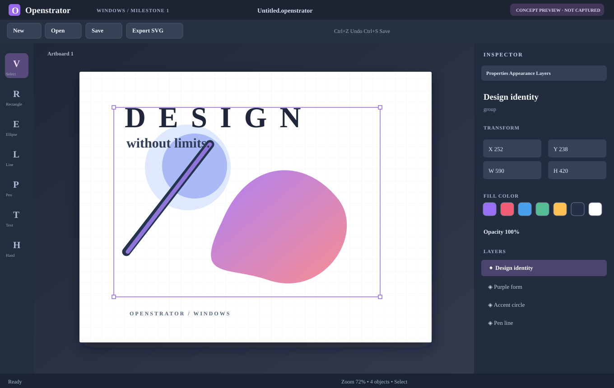

# Openstrator — Windows M1 (native C++20)

This is the first Windows port milestone, **not yet macOS V6 M6 feature parity**.

**Stack:** native C++20, Win32, hardware-accelerated Direct2D and DirectWrite, CMake, Visual Studio 2022 / Windows SDK. No Electron or external runtime.

The portable core follows the common JSON .openstrator document schema recovered from macOS M6. SwiftUI and AppKit have been reimplemented with original Windows code, not merely translated.

## Interface preview

This preview shows the planned layout, not a verified screen capture of the running EXE.

## Build on Windows 10/11

Install **Visual Studio 2022** with **Desktop development with C++** and the Windows SDK. Open PowerShell at the repository root:

~~~powershell
cmake -S windows -B windows/build -A x64
cmake --build windows/build --config Release --parallel
ctest --test-dir windows/build -C Release --output-on-failure
~~~

Run windows/build/Release/Openstrator.exe.

### Prebuilt Windows ZIP

[Download the verified Windows M1 x64 ZIP](../releases/Openstrator-Windows-M1-x64.zip), extract it and launch Openstrator.exe. This executable is **unsigned** (Windows SmartScreen may warn); no macOS machine is needed. Native runtime UI testing on the user's Windows PC is still required.

[Windows builds and downloadable artifacts](https://github.com/infernaldudd/Openstrator/actions/workflows/windows-build.yml) will be generated when GitHub Actions runs successfully.

## Functional M1 tools

- Dark native editor with artboard, toolbox, inspector and selection via layers.
- Rectangles, ellipses, lines, Pen point-paths, basic text and display of stored cubic curves.
- Select, move, delete, fill color swatches, undo/redo (64 checkpoints), zoom/pan and grid display.
- Native new/open/save .openstrator (JSON) and basic SVG export.
- Import common macOS M6 VectorObject fields, preserving unknown JSON metadata.

**Compatibility caveat:** M6 advanced typography, symbols, images, masks, live appearances, effects, gradient stacks and raster editing are not yet rendered faithfully. Imported M6 documents with advanced data are *saved as new files*, preserving the original. SVG export omits unsupported images/effects. This is NOT a full macOS M6 replacement.

## Shortcuts

V Select, R Rectangle, E Ellipse, L Line, P Pen, T Text, H Hand. Double-click/Enter finishes a Pen path; F2/double-click edits selected text. Ctrl+N/O/S/Shift+S creates/opens/saves/save-as; Ctrl+Z/Y undo/redo; Ctrl+E exports SVG, Ctrl+G toggles grid; mouse wheel zooms; Delete removes the selected object; F1 opens keyboard help.

## Planned next milestones

M2: cubic control-handle editing, resizing and full multi-artboard support.
M3: advanced typography and appearance/effects.
M4: raster engine and image editing.
M5: layers/masks/symbols/filters parity with the macOS version.

macOS source remains in [src/](../src); the original V6 M6 packages remain in [releases/](../releases).
